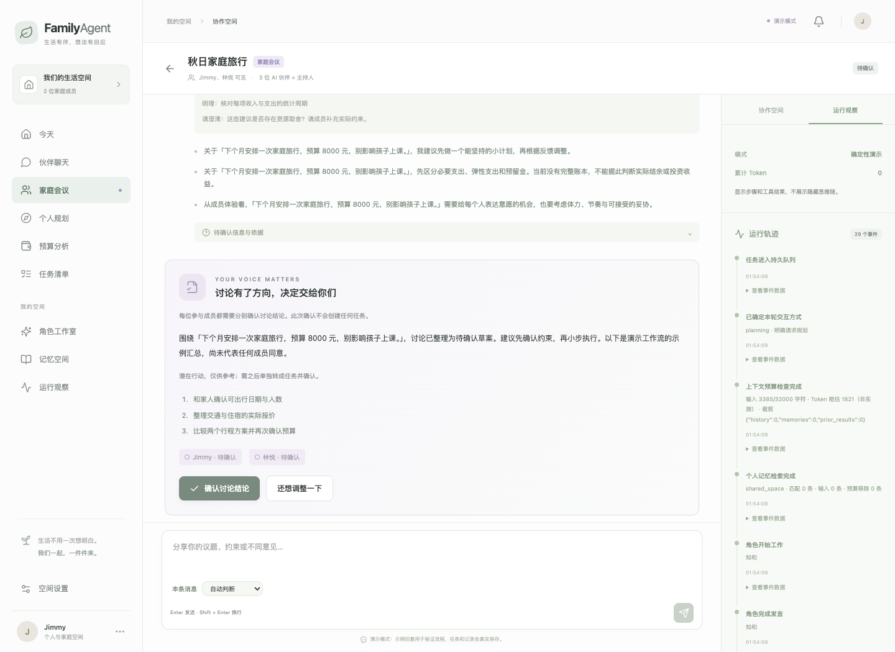

# FamilyAgent

一个可以实际操作的个人与家庭多 Agent 协作空间。React + TypeScript 网页，FastAPI 后端，SQLite 持久化，统一 Harness 与持久 Worker。

[](https://github.com/JimmyFengCJY/FamilyAgent/actions/workflows/ci.yml)
[](LICENSE)



[44 秒网页演示（合成数据、demo 回复）](docs/assets/demo.webm) · [架构与取舍](docs/12-architecture.md) · [五分钟演示与面试准备](docs/13-demo-and-interview.md) · [贡献指南](CONTRIBUTING.md)

核心实现包括三种编排策略、角色上下文、带引用的分歧汇总、人工审批、私有记忆检索、MCP stdio 工具、事务检查点、租约心跳和故障恢复。Agent 通过 Harness 的结构化结果与上下文通信；当前没有实现跨服务标准 A2A 协议。

## Docker / Compose

已提供 API + 独立 Worker、共享持久卷和默认 demo 模式：

```bash
docker compose --env-file /dev/null up --build -d --wait
```

构建/启动成功后访问 `http://127.0.0.1:8080/`，注册本地账号即可体验，无需模型密钥。默认不加载本机模型配置或绑定主机数据库。真实模型覆盖、数据管理与冒烟步骤见 [容器部署说明](docs/11-containers.md)。

**云端容器已验收通过**：[CI 40226597155](https://github.com/JimmyFengCJY/FamilyAgent/actions/runs/40226597155) 实际完成镜像构建、API/独立 Worker、MCP、任务与重启持久化验证。本机 Docker Hub TLS 超时仍待解决，不代表本机 8080 已运行。

## 先体验

macOS 可双击 **启动FamilyAgent.command**。也可在项目目录运行：

```sh
python3 scripts/start.py
```

启动脚本会准备缺少的依赖、构建网页、启动本机服务并打开浏览器。当前依赖要求 Python 3.11+（实际验证与推荐版本为 3.12），SQLite 3.31+（含 JSON 支持），以及 Node.js 20.19+ / 22.12+，首次安装依赖需要联网。

打开 [本机网页版](http://127.0.0.1:8000)，点击“免配置，体验完整工作流”。默认是明确标记的**确定性演示模式**：回复是示例，不是真实 LLM 推理；账号、会话、确认、任务、记忆、预算计算与执行事件都真实运行并保存。

停止后记录仍在 `data/familyagent.sqlite3`。不要把 `data/`、密钥或环境文件提交到版本库。此版本面向本机开发验证，默认只监听 127.0.0.1，不应直接暴露到公网。

## 当前优化进度

各轮改前/改后、具体例子、收益和取舍见 [优化对比记录](docs/04-improvements.md)。

每轮优化、验证证据、未完成事项和下一步持续记录在 [项目进度](docs/PROGRESS.md)。当前已推进到 R15：真实 CI、容器验收、限额真实模型评测与开源材料。真实质量结论及未完成项以最新进度记录为准。

## 推荐验证路径

1. **家庭会议**：邀请 Jimmy 与林悦，输入旅行议题。新会议默认独立首轮分析，也可选择顺序讨论或单助手。查看独立观点、AI 共同建议、分歧引用及待澄清问题，再确认草案。旧会议保留原策略。
2. Jimmy 确认讨论结论后，切换林悦并确认；这一步仍不会创建任务。切回 Jimmy，在同一会议中选择“整理为任务草案”，预览并再次确认后查看任务。
3. **伙伴聊天**：普通问答只解释；倾听不弹任务；建议可主动转成草案，确认后才创建。输入框可以选择本条消息的处理方式。切换家庭成员验证私密会话与记忆隔离。
4. **个人规划**：输入目标与时间约束，确认草案后检查任务清单。完成、重新打开或归档任务。
5. **预算分析**：修改示例数据，精确计算，再请明理分析。数值使用 Decimal，不靠模型口算。
6. **角色工作室**：复制预设或创建新角色，调整人格，再开启新会话。旧会话保留旧版本。
7. **运行观察**：查看角色、工具、检查点与确认事件。在会话侧栏把调用上限设为 1，验证耗尽后继续；也可暂停、恢复和停止。
8. **提醒与记忆**：新建任务并设置时间，服务运行时到期生成应用内通知。主动保存偏好，在新建个人会话时选择参考记忆。

体验账号是明确的本机测试身份，不是真实家庭成员身份验证。独立账号支持注册/登录；设置中生成的一次性邀请码可让新注册账号加入同一家庭。没有填写邀请码会创建独立家庭。

## 接入真实模型

已实现 Claude、DeepSeek、Gemini 三家原生 HTTP 接口，共用结构化结果、错误分类和用量记录。使用账号可用的模型 ID，不在前端填写或保存密钥：

| 供应商 | FAMILYAGENT_PROVIDER | 密钥变量 | 模型变量 |
| --- | --- | --- | --- |
| Claude | anthropic 或 claude | ANTHROPIC_API_KEY | ANTHROPIC_MODEL |
| DeepSeek | deepseek | DEEPSEEK_API_KEY | DEEPSEEK_MODEL |
| Gemini Developer API | gemini | GEMINI_API_KEY | GEMINI_MODEL |

FAMILYAGENT_MODEL 可统一覆盖模型变量；切换供应商前应清除旧值，或设置为目标供应商的模型 ID。不预设“最新”模型，避免账号权限和模型下线差异。Gemini 当前接入 Google AI Studio / Developer API，不包含 Vertex AI 身份认证。

将以下配置填写到项目根目录的 `.env`（不要提交密钥）：

```dotenv
FAMILYAGENT_PROVIDER=anthropic
ANTHROPIC_MODEL='你的模型ID'
ANTHROPIC_API_KEY='你的API密钥'
FAMILYAGENT_DEMO_LOGIN=0
```

保存后运行 `python3 scripts/start.py`。启动脚本显示供应商与模型，不显示密钥；检测到旧服务配置不同会提示停止旧服务，不会静默复用。

需要先停止已有服务，使新环境生效。启用真实模型会产生供应商费用；本版提供模型调用次数和单次输出上限，尚未实现金额/token 总预算硬限制。真实模型连接尚未用用户密钥实测。配置失败会明确报错，不会静默切换到演示。

`scripts/start.py` 会自动读取项目根目录的 `.env`，文件中的配置优先；不再需要手动 source。使用 `--no-env-file` 可完全使用终端环境。直接运行 uvicorn、独立 Worker 或评测命令时仍需自行加载环境变量。禁用体验登录后，旧体验账号和其会话也不能用于登录；可注册独立账号。

适配器接口是 `models.py: ModelGateway.generate(context) → (result, usage)`。通过服务端配置切换供应商，业务编排不依赖某个 SDK。每次新运行保存不含密钥的模型配置快照，Worker 配置发生变化时拒绝静默混用模型。截断、拦截和非法结构化输出会失败，格式重试的已报告用量也会记录。

参考：[Claude Messages API](https://platform.claude.com/docs/en/api/messages/create)、[DeepSeek Chat Completions](https://api-docs.deepseek.com/api/create-chat-completion/)、[Gemini generateContent](https://ai.google.dev/api/generate-content)。三家适配器已使用模拟 HTTP 测试，尚未使用真实密钥验证。

## 基线评测

```sh
# 20 个合成案例，会议对比单 Agent / 多 Agent，不产生外部调用
.venv312/bin/python -m evals.run --provider demo

# 本机配置密钥和模型后，先小规模试跑 Claude；--live 明确启用付费调用
.venv312/bin/python -m evals.run --provider claude --live --case meeting-trip --max-total-calls 8
```

结果保存在被 Git 忽略的 `evals/results/`：包含输入与结构化输出、模型/数据/代码指纹、耗时、Token、工程检查和人工评分表。默认 26 次运行、正常情况下 50 次演示调用。报告不会把未评审的建议标记为质量通过。

DeepSeek、Gemini 参数、重复实验与人工评分见 [评测说明](evals/README.md)。

## 开发与测试

```sh
# 后端；也负责提供已构建的网页
.venv312/bin/python -m uvicorn services.api.app.main:app --host 127.0.0.1 --port 8000

# 开发网页，API 请求转发到 8000
npm run dev

# 类型检查 + 网页构建
npm run build

# 后端测试，使用临时隔离数据库
.venv312/bin/python -m pytest -q

# 统一离线检查（依赖需预先安装；顺序执行测试、构建、评测、浏览器）
.venv312/bin/python scripts/check.py

# 真实浏览器流程测试，独立服务和临时数据库
npm run test:browser
```

浏览器测试截图在 `test-results/`，不会提交。可通过 `PYTHON_BIN`、`CHROME_PATH` 指定解释器和 Chrome；没有本机 Chrome 时使用 Playwright 浏览器（首次运行 `npx playwright install chromium`）。测试服务使用 8010 端口；不要同时运行两份浏览器测试。

已加入后端/离线评测与网页/浏览器两个 GitHub Actions 作业；本地共用同一检查入口。触发条件、产物、权限与验证范围见 [CI 说明](docs/10-ci.md)。工作流尚未发布到远端，不代表云端已运行通过。

网页构建不要与同一目录下的网页浏览器测试同时执行。后端测试不依赖网页资源，但开发服务器可能短暂读取到正在重建的资源。

后端 API 文档：[本机接口文档](http://127.0.0.1:8000/docs)。Python 依赖的当前验证版本记录在 `requirements.lock`；网页依赖固定在 `package-lock.json`。

## 已实现的 Harness

| 能力 | 当前实现 |
| --- | --- |
| 角色/能力分离 | 5 个预设、可定制人格、能力白名单、版本快照 |
| 路由与多 Agent | 个人单角色；会议主持 + 最多 3 专家 + 汇总；独立或顺序分析可选，分歧引用原文 |
| 有界循环 | 模型输出 → 校验 → 授权工具 → 再调用；最多 12 次调用 |
| 工具 | 统一注册表、输入 JSON Schema、角色/空间/入口授权；Decimal 预算、待办筛选、确认后批量建任务 |
| 上下文 | 输入字符预算、持续约束快照、超限前置拒绝、裁剪轨迹；Token 粗估与实际用量分开 |
| 记忆 | 手动保存/删除；授权后按问题与持续约束词面检索，最多 6 条；展示实际输入来源，删除后来源不再展示原文 |
| 持久运行 | SQLite 队列、步骤/只读工具检查点、120 秒租约、30 秒心跳（每代次最多续租 10 分钟）与执行代次，事务外工具等待及旧结果丢弃 |
| 用户介入 | 暂停、恢复、取消、逐成员确认会议结论；任务单独预览确认 |
| 审批与幂等 | 草案版本/哈希/有效期，确认与任务创建同一事务，稳定任务 ID |
| 错误与重试 | 暂时故障有限重试，格式纠正一次，均计入调用预算 |
| 可观察 | 持久事件、轮询网页、可恢复 SSE、Token 用量，不展示隐藏思维链 |
| 调度 | 带时区的提醒时间、重启后补发应用内提醒、去重 |
| 数据权限 | 独立账号、家庭/会议成员 ACL、私密空间隔离、服务端工具授权 |

Worker 默认嵌入 API 进程的独立线程，便于一次启动。也支持独立进程：

```sh
FAMILYAGENT_EMBEDDED_WORKER=0 .venv312/bin/python -m uvicorn services.api.app.main:app --host 127.0.0.1 --port 8000
.venv312/bin/python -m services.api.app.worker
```

两个进程需要使用同一数据库路径与模型配置。已完成步骤不会重复写入；进程在模型调用期间退出时，该次未提交的模型调用可能重做，可能再次计费。工具目前仅有本地事务写入/只读操作，没有对外发送、购买或交易。

模型只读工具使用“短事务准备 → 事务外执行 → 短事务复核提交”，等待时不持有写事务。暂停、取消、租约过期或执行代次变化后，迟到结果不会覆盖当前状态；工具检查点可恢复，但底层只读调用可能重做。默认 Worker 仍单线程，取消不保证立即中断底层操作。设计和边界见 [执行层说明](docs/06-execution.md) 与 [租约及进程故障说明](docs/09-worker-leases.md)。

网页会话首次读取最近 50 条消息，支持加载更早消息与增量轮询；工作台使用运行摘要，进入运行观察再读取完整记录。参考记忆展开时独立复核删除与权限状态。接口兼容与限制见 [数据加载说明](docs/08-data-loading.md)。

## 与完整设计的差异

这是第一版可验证实现，尚未完成完整生产系统：

- SQLite 替代 PostgreSQL；已将运行与消息拆为独立表，保留 JSON 扩展负载，加入生成列约束、定向索引和 v3 原子搬迁；其余业务对象尚未拆表，也未完成生产压测。升级前应停止共享数据库的各进程并备份，见 [数据库说明](docs/07-database.md)。
- 专家仍串行执行，新会议默认隔离本轮前序发言进行独立分析，旧会议保留原策略。汇总校验分歧引用出处，不保证冲突推断或观点正确；尚无自动第二轮、专家并行和动态专家选择，可追加消息澄清。
- 历史上下文为有界消息视图；新建空间可填写持续约束（最多 8 条，每条 200 字），每次运行快照保留。系统提示与上下文 JSON 合计上限 32000 字符，先移除旧历史、记忆和前序结果；当前问题、持续约束、角色、工具/财务结果、归属专家结果不裁剪，仍超限就停止且不调用模型。Token 仅按 UTF-8 字节粗估，非供应商精确计数或金额预算。尚无自动约束提取、长期摘要、向量 RAG 或文档导入。
- 记忆检索是本地中文双字片段/英文单词的词面匹配，不是向量语义检索；先按所有者与私密范围过滤，再排序取最多 6 条，无匹配不注入。输入预算不足先移除低分记忆。仅个人空间显式开启后使用；家庭会议与情绪支持不查询个人记忆。回答下方可查看实际加入该次调用输入的记录和来源，不能据此认为回答实际引用、事实正确或记忆仍然适用。删除/变更后来源原文不再展示，历史生成回复不会自动清除；再次检索不加载已删除原记录，历史回复仍可能包含过去生成的内容。
- 工具在 tool_registry.py 注册名称、输入 Schema、风险、入口与能力。模型只获得当前角色/空间允许的只读工具，仍由服务端重新授权；身份、审批和来源入口不接受模型传参。任务创建仅通过有效草案确认，保持同事务回滚和稳定任务 ID。登录后 GET /api/tools 可查看目录，网页协作面板展示工具权限。新增 reference.search 通过官方 SDK 连接内置 MCP stdio 参考服务，有操作超时和输出验收；这不是任意远程 MCP 支持或 OS 沙箱。

本地 MCP 可在对话协作面板点击“检索本地 MCP 参考库”验证，无需模型额度。只读取项目自编的目标/学习/会议参考资料，默认不访问个人数据库或网络；协议、权限与限制见 [MCP 实现说明](docs/05-mcp.md)。
- 计划已保存阶段建议、关联任务与完成进度；尚无计划版本编辑器、日历排期和任务转派接受流程。
- 会议信任来源是真实账号分别确认，当前草案任务分配给发起人，预览明确展示；不代替其他成员承诺任务。
- 提醒是服务运行期间的应用内通知，没有系统后台常驻、邮件/手机推送或外部日历。
- 有基础情绪危机支持分支和提示策略，尚未经专业危机评审，不用于诊断、治疗或应急服务。
- 未实现完整金额预算、费用估算、外部调用未知结果对账、监控平台、角色归档和会话分支。
- 账号使用加盐 PBKDF2 密码和 HttpOnly 会话，含来源检查与简单限流；尚无邮箱验证、找回密码、成员移除、备份治理和生产安全审计。

下一步建议：先接真实模型评估角色协作质量，再优化会议收敛、个人计划结构和记忆检索。

对标方向与实现边界见 [对标参考项目](docs/03-benchmarks.md)。

需求与架构见 [需求分析](docs/01-requirements.md) 和 [系统设计](docs/02-system-design.md)。
