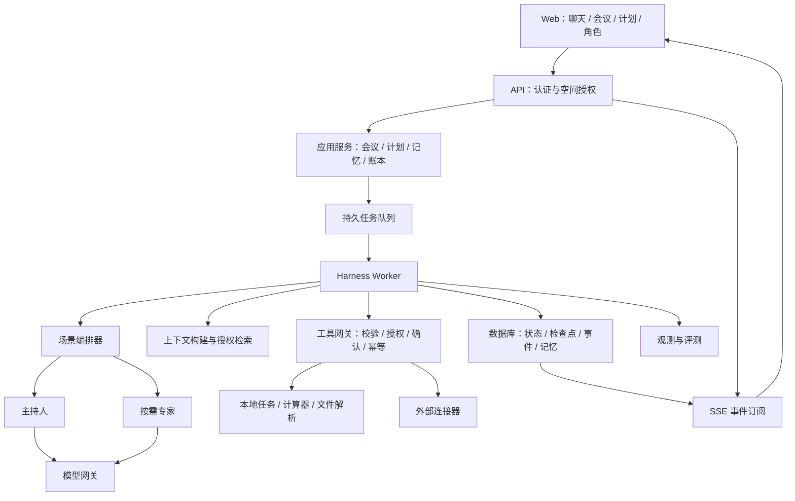

# FamilyAgent 系统设计

版本：v0.1 设计草案 · 2026-10-13
前置文档：[需求分析](01-requirements.md)

## 1. 核心决策

采用模块化单体后端、独立任务 Worker、统一 Agent Harness。用受控的主持人/专家协作实现多 Agent，以事件记录和检查点支撑长任务。初期不拆微服务、不建设任意 Agent 点对点聊天网络。

**人格是呈现，能力是职责，Harness 是执行和约束，成员才拥有决策权。**

这里的 Harness 指包围模型的运行系统：组装上下文、管理步骤、调用工具、检查权限、记录状态、控制成本、处理中断并验证结果。它不是提示词集合，也不是角色列表。

参考工程资料区分工作流与自主 Agent，并强调用持久状态支撑跨上下文持续工作。本设计将其应用到家庭协作，并不照搬编码 Agent 的文件工作流。

- [Building Effective Agents](https://www.anthropic.com/engineering/building-effective-agents)
- [Effective harnesses for long-running agents](https://www.anthropic.com/engineering/effective-harnesses-for-long-running-agents)

## 2. 逻辑架构



浏览器不直接持有模型密钥或连接器凭据。Worker 与 API 初期共享代码和数据库，以不同进程运行。事件流由应用层按权限读取已提交事件，不直接暴露数据库。

## 3. Agent 模型与人格隔离

建议初始能力：主持人、规划师、情绪支持伙伴、财务分析师、个人助手。质检先做确定性校验，复杂输出才按需增加一次模型审阅。

角色配置示例：

```yaml
id: planner_warm
version: 1
persona:
  display_name: 温和规划师
  tone: 温和、具体、少说教
capabilities:
  - goal_clarification
  - plan_decomposition
tools:
  - task.propose
  - calendar.read
memory_policy: personal_opt_in
output_schema: PlanProposalV1
```

配置只能声明请求的权限，不能自行授予权限。实际权限为：平台允许 ∩ 账号授权 ∩ 当前空间 ACL ∩ 本次运行范围 ∩ 角色白名单。配置文件中的任意字段均不能覆盖代码权限检查。

每次 Agent 调用包括：系统规则、角色版本、当前子任务、授权上下文、可用工具、结构化输出约束。专家之间通过结构化结果交换观点，不自动共享全部私人聊天。

输出公共字段：`summary`、`proposals`、`evidence_refs`、`assumptions`、`missing_information`、`risks`、`suggested_actions`。不同场景扩展自己的 schema。置信表达不能视为准确率保证。

## 4. 场景编排

### 4.1 简单任务路由

普通聊天 → 一个角色；单项计算 → 一个能力加工具；多个领域或用户指定多人讨论 → 启用协作。路由先用明确模式和规则，歧义时才使用模型分类。

多 Agent 的价值来自职责、工具与上下文的区别，同一模型多次扮演不同身份并不天然带来更高质量。每个场景必须与单 Agent 基线比较。

### 4.2 家庭会议工作流


专家首轮可以并行，最多 3 个；第二轮仅把相关分歧及授权资料发给对应角色。不能因为角色人数增加就重复全量上下文。

会议业务状态：`draft → collecting → discussing → decision_pending → concluded`，允许暂停和取消。运行结束不等于会议决议获批准。决议默认由提议人确认并由受影响成员明确接受，家庭可另配表决规则；缺席与沉默不算同意。

### 4.3 规划、情绪支持与财务

规划：结构化目标 → 规划草案 → 校验时间/资源冲突 → 用户接受 → 创建任务 → 定时复盘。默认一个规划师；需要交叉判断才加专家。

情绪支持：默认一个稳定角色、独立私密会话；用户选择的沟通模式优先。跨场景转发只能通过用户审阅的共享片段。危机状态使用独立策略与经评审模板，不能只依赖角色提示词。

财务：导入 → 隔离解析 → 用户确认标准化数据 → 确定性计算 → 分析解释 → 引用与假设校验。上传文件中的文字是数据，不能变成工具执行指令。

## 5. Harness 运行循环

```text
接收请求并验证身份、空间、输入与预算
创建 run，保存配置版本，写入队列 outbox
Worker 获取租约并加载检查点
while 未进入终态:
    重新检查取消、权限变更、期限和剩余预算
    根据场景状态确定下一步骤
    构建此 Agent 的授权上下文
    若需模型：调用模型网关并校验结构化响应
    若需工具：校验参数、权限和动作风险
        需要确认：保存不可变动作提案，暂停运行
        已授权：按幂等键执行并记录结果
    提交事件与检查点，推进场景状态
输出完整结果或明确说明未完成部分
```

运行状态：`queued / running / waiting_user / waiting_approval / succeeded / failed / cancelled / exhausted`。业务会议状态独立保存；单个 run 可以暂停，会议也可以跨多个 run 继续。

用户插话先成为新事件；编排器在安全步骤边界重新规划。已有外部动作不能假设被撤销，需返回实际结果。

## 6. 常见 Harness 知识点映射

| 知识点 | 本项目落地 | 演示/验证方式 |
| --- | --- | --- |
| Agent loop | 有界的模型—工具—结果循环 | 财务计算后解释结果 |
| Workflow 与动态规划 | 明确场景状态机，复杂议题动态分解 | 旅行会议生成子问题 |
| Routing / handoff | 分类到能力，交接结构化任务 | 助手转交规划师 |
| 多 Agent 协作 | 主持人调度、独立专家、有限回应 | 预算与时间方案比较 |
| Tool calling | Schema、超时、结果归一化 | 待办、计算、检索 |
| Context engineering | 按角色装配上下文、摘要、检索预算 | 长会议不中断主题 |
| Memory / RAG | 私人/共享记忆分区、来源、过期与删除 | 只召回授权偏好 |
| Checkpoint / resume | 步骤检查点、租约、持久事件 | 重启后恢复讨论 |
| Human in the loop | 等待输入、不可变动作审批 | 确认写入共享日历 |
| Policy / sandbox | 服务端权限、文件解析隔离、网络限制 | 恶意附件无法越权 |
| Reliability | 分类重试、幂等、未知结果对账 | 超时后不重复写日程 |
| Budget / termination | 调用、轮次、token、费用和时限预算 | 耗尽后输出阶段性结论 |
| Observability | 可关联轨迹、事件、版本与成本 | 定位失败工具步骤 |
| Evals | 固定数据集、确定性校验、人工评分 | 多 Agent 与单 Agent 对比 |
| Scheduling | 持久提醒、时区、去重与取消 | 到期提醒与会议复盘 |

## 7. 上下文与记忆

上下文构建顺序：系统约束 → 当前任务 → 角色配置 → 相关成员输入 → 已确认结构化状态 → 授权检索结果 → 必要工具输出。预算不足优先保留当前目标、约束和未完成动作。

记忆分层：

- 工作记忆：当前 run 的临时信息与检查点。
- 会话记忆：对话原文、摘要、已确认结论、未决事项。
- 长期个人记忆：明确偏好、长期目标；默认需要用户开启。
- 家庭共享记忆：经明确共享的决议、规则和公共计划。
- 外部知识：带来源与时间的检索资料，与用户个人事实分开。

每条记忆带 `owner_id`、`household_id?`、`visibility`、`source_ref`、`sensitivity`、`created_at`、`expires_at?`、`version`。摘要继承来源中最严格的权限，不能把多个私密来源摘要后降级为共享。

向量相似度不是授权。先过滤允许的资源范围再检索，取回后再次校验；检索缓存键包含身份、权限版本和空间。用户离开家庭后，恢复旧任务时也必须重新授权。

用户可查看、修改、纠正与删除记忆。矛盾偏好先保存时间与出处，需要时询问，不能静默覆盖。敏感日志默认只记元数据，原文需单独授权和保留策略。

## 8. 工具网关与审批

工具注册字段：`name / version / input_schema / output_schema / risk_level / required_scopes / timeout / retry_policy / supports_idempotency`。

风险分层：

| 层级 | 例子 | 执行方式 |
| --- | --- | --- |
| L0 只读与计算 | 查授权待办、预算计算 | 有权限即可执行 |
| L1 本地可逆写入 | 按明确指令创建个人待办 | 指令授权内执行，提供撤销 |
| L2 外部影响或共享 | 对外发送、共享日程、发布私密片段 | 预览具体内容后确认 |
| L3 首版禁用 | 交易、转账、医疗处方 | 不注册执行工具 |

批准记录绑定用户、工具版本、标准化参数哈希、目标资源、run、过期时间和一次性消费状态。批准后若接收者、金额或内容变化，旧批准失效。真正执行时再次校验权限。

审批不能替代业务授权：一名成员不能批准读取另一名成员私密聊天。任务接受与工具执行审批也是不同对象。

外部资料、角色设定与工具输出均视为不可信输入；不可覆写系统规则。工具网关独立执行权限与字段校验；连接器凭据保存在服务端，模型不可读取。

## 9. 持久化、并发与故障恢复

初版使用关系数据库保存状态、事件与作业。API 在同一事务创建 run 和 outbox 事件；Worker 消费持久队列，使用租约与版本检查保证一个步骤只有一个有效执行者。

事件记录单调序号，检查点保存已完成节点和后续计划。重放事件用于恢复应用状态，不自动重放有副作用的工具。模型调用输入与返回存为有保留策略的工件，避免重启后重复无必要生成。

外部调用与数据库无法天然形成一个原子事务。执行动作使用稳定的 `action_id` 和供应商幂等键；本地结果以唯一约束去重。外部工具不支持幂等且调用超时，进入 `outcome_unknown` 动作状态，先查询对账或等待用户处理，不能盲目重试。

并发成员发言按服务器事件序号记录；同一决议用 `expected_version` 乐观并发控制，冲突返回最新版本待重新确认。

可恢复错误：网络抖动、限流、暂时不可用，有限次退避。不可恢复错误：权限拒绝、非法输入。结构化响应最多纠正一次；专家失败可带明确缺失项继续总结，不能编造其意见。

调度器保存 `timezone`、本地计划和 UTC 触发时间；提醒发生后记录交付结果并去重。重启后的过期任务按配置补发或跳过，不无限补发。用户时区默认采用账号设置。

## 10. 数据模型

| 实体 | 关键字段与作用 |
| --- | --- |
| User / Household / Membership | 身份、家庭、成员资格与角色 |
| Space / ResourceGrant | 个人/家庭/会议空间及资源共享授权 |
| Character / CharacterVersion | 人格配置及不可变历史版本 |
| Conversation / Message | 空间、发送者类型、正文、父消息/分支 |
| Meeting / Participant | 议题、参与者、议程、业务状态 |
| Decision / DecisionAcceptance | 决议版本、成员接受/拒绝与时间 |
| Run / Step / Checkpoint | 运行状态、步骤、租约、预算、配置版本 |
| RunEvent | run、序号、事件类型、可见范围、载荷引用 |
| ToolInvocation / ActionProposal / Approval | 工具输入输出、执行状态、审批绑定 |
| Goal / Plan / Task / TaskAcceptance | 目标、计划版本、任务、承接状态 |
| Schedule / Delivery | 触发规则、时区、提醒交付与去重 |
| Memory / MemorySource | 记忆、权限、来源、过期与派生关系 |
| Document / Chunk / Embedding | 文件、授权片段、检索索引 |
| Ledger / Transaction / Analysis | 账本、金额币种日期、分析出处 |
| ConnectorGrant / AuditEvent | 外部授权元数据、安全审计 |

金额用十进制定点或最小货币单位整数，禁止浮点金额累加。所有受保护资源带所有者/空间归属；“知道资源 ID”不构成访问权。

## 11. API 与事件协议

建议 REST 管理业务资源，SSE 推送执行进度。异步任务返回 `202 + run_id`。

```text
POST /v1/conversations
POST /v1/conversations/{id}/messages
POST /v1/meetings
POST /v1/meetings/{id}/runs
POST /v1/decisions/{id}/acceptances
POST /v1/tasks/{id}/acceptances
GET  /v1/runs/{id}
GET  /v1/runs/{id}/events
POST /v1/runs/{id}/cancel
POST /v1/runs/{id}/resume
POST /v1/action-proposals/{id}/approvals
GET  /v1/memories
DELETE /v1/memories/{id}
```

事件公共字段：`event_id / run_id / seq / type / actor_id / created_at / payload`。事件类型包括 `run.started`、`agent.started`、`message.delta`、`tool.started`、`tool.completed`、`approval.required`、`run.paused`、`run.completed`、`run.failed`。

事件日志按至少一次交付设计，前端按 `event_id` 去重，断线后按序号恢复。每次订阅和补发均检查资源访问权；成员资格撤销后终止订阅。消息增量只表示生成中，最终消息另行落库确认。

## 12. 技术选型建议

这是一套初始组合，不是已经完成依赖兼容性验证的版本清单。

| 层 | 建议 | 原因 |
| --- | --- | --- |
| 前端 | React + TypeScript | 会话、角色和会议状态交互 |
| 后端 | Python + FastAPI | 清晰的类型接口与 Agent 工具开发 |
| 状态与记忆 | PostgreSQL，按需启用 pgvector | 事务、权限归属、检索共用基础设施 |
| 作业与调度 | 初期数据库持久队列 + 独立 Worker | 减少组件，支持租约与恢复 |
| 文件 | 开发期本地文件；部署期兼容对象存储 | 原始文件与分析工件分离 |
| 模型层 | 自有薄适配器 | 隔离供应商请求、工具协议与用量差异 |
| 观测 | 结构化日志与 OpenTelemetry 风格链路 | 关联运行、步骤和工具 |

编排先实现少量显式状态机和统一接口；若检查点、分支和人工中断维护成本明显增加，再评估图编排框架。是否引入框架不改变权限、幂等与业务数据的责任边界。安装前再核对当前文档、版本和许可。

建议目录：

```text
apps/web/
services/api/app/
  auth/           # 账号、成员、资源授权
  domains/        # 会议、规划、任务、财务
  harness/        # 循环、状态、预算、恢复
  orchestration/  # 场景工作流与角色调度
  characters/     # 人格配置及版本
  memory/         # 记忆、检索与删除
  tools/          # 注册、授权、执行与连接器
  models/         # 模型网关
  jobs/           # Worker、租约与调度
  observability/  # 事件与指标
evals/            # 场景案例、评分与基线
docs/
```

## 13. 验证与开发顺序

第一步做完整的单 Agent 垂直链路：请求 → 运行 → 模型 → 一个本地工具 → 事件 → 恢复。第二步增加角色版本、路由与主持人工作流。第三步完成真实多人身份、决议接受和共享权限，再扩展记忆、提醒与财务。

首批评测建议覆盖约 30 个固定场景，包含：家庭意见冲突、缺席成员、无法完成目标、长对话压缩、敏感聊天误共享、恶意附件、模型格式错误、工具限流、审批过期、重启重复执行、跨家庭检索、外部调用结果未知。

工程校验关注权限、幂等、状态转换、计算和恢复。产品评测关注结论可用性、分歧保留、行动清晰度、情绪支持体验。模型评分只辅助，心理支持及高影响财务样本需要人工评审。

记录单 Agent 与多 Agent 的完成率、质量、耗时和成本；多 Agent 没有收益的场景回退到单 Agent。先积累基线再确定质量阈值，不能把未知指标写成已达标结果。

## 14. 示例：旅行会议的完整链路

用户：“下个月安排一次家庭旅行，总预算 8000 元，别影响孩子上课。”

1. 主持人明确参与成员、出发地、人数、日期、预算是否含交通；信息缺失时不直接给确定报价。
2. 规划师给出日程选项；财务分析师通过计算工具做预算分解；资料不足时列明假设。
3. 主持人汇总方案与分歧，真实成员选择或提出修改。
4. 系统保存决议草稿，受影响成员接受后才标记确认。
5. 生成订票、查住宿等待接受任务；没有注册购买工具，因此不自动下单。
6. 写入共享日历时展示日期、参与人和内容，完成确认后执行。
7. Worker 若在执行后崩溃，恢复时查询动作结果并对账，避免重复创建。
8. 复盘触发时只读取该会议授权数据，输出任务进展。

这个链路同时验证角色扮演、有限多 Agent 协作、工具调用、上下文、持久状态、审批、幂等、调度和观测。
