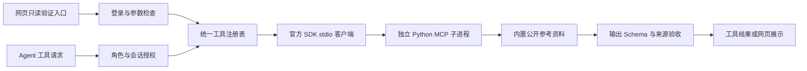

# 本地只读 MCP 集成

本轮使用官方 MCP Python SDK 1.30.0 的维护版本线，固定验证协议版本 2025-11-25，控制本轮互操作范围，不同时引入 SDK v2 的协议迁移。SDK v2 已存在，不能称本实现为最新 SDK/协议。当前实际运行验证使用 Python 3.12，未实测其他 Python/操作系统。

规范依据：[stdio 传输](https://modelcontextprotocol.io/specification/2025-11-25/basic/transports)、[生命周期](https://modelcontextprotocol.io/specification/2025-11-25/basic/lifecycle)、[工具发现与调用](https://modelcontextprotocol.io/specification/2025-11-25/server/tools)、[官方 SDK v1 文档](https://github.com/modelcontextprotocol/python-sdk/tree/v1.x)。

## 调用链



服务提供 `search_reference`，应用映射为固定名称 `reference.search`。内容为本项目自编的目标拆解、学习复盘和家庭会议参考资料，不是实时搜索结果、个人记忆或专业知识权威来源。

客户端先 initialize（SDK 发送 initialized 通知），再 tools/list，验证工具白名单、输入与输出 Schema，再 tools/call。只接受声明版本、已注册服务与有界结构化结果；结果中包含本地来源标识。

## 如何验证

1. 在 8011 离线预览进入任意对话的协作面板，找到“MCP 本地参考库”。
2. 检索“目标拆解”，查看连接结果、stdio、协议版本与参考资料来源。
3. 此按钮直接走登录后的只读工具入口，不调用模型，不创建任务。情绪支持角色不会自动获得该工具；用户手动点击公共参考库是独立行为。

开发命令：

```sh
.venv312/bin/python -m pytest tests/test_mcp.py -q
# 启动服务供其他客户端按 stdio 连接；stdout 只用于 MCP 消息
.venv312/bin/python services/mcp_reference/server.py
```

API：`POST /api/mcp/reference/probe`，需登录，参数为 `{"query":"目标拆解","limit":3}`。这不是对外提供的通用 MCP HTTP 端点，只是本应用的固定服务验证接口。没有接入任意命令、URL、路径或其他用户身份的参数。

## 权限与故障边界

- Agent 入口只允许 planner / assistant / host，执行前复核会话权限；情绪支持空间关闭，finance 角色不开放。原任务写工具仍必须走独立审批。
- 服务命令由代码固定为当前虚拟环境解释器及内置脚本绝对路径，不经过 shell。工作目录为服务目录，避免从项目根目录加载 .env；SDK 仅继承基础 OS 环境白名单，不复制应用密钥和数据库环境变量。
- 子进程只收到 query 和 limit，不自动接收账号、对话历史、记忆或数据库路径。用户/模型提供的查询本身仍可能含个人信息，不能把“没有自动附带”说成“查询绝不会含个人信息”。
- 客户端验证输入、发现的 Schema、结果 Schema、条数及来源 ID，一次结构化结果验收上限 16000 UTF-8 字节；这不是传输层内存硬上限。
- MCP 操作窗口默认 10 秒，超时结束连接、不自动重试；Python 首次导入与进程清理可能额外耗时。错误不会当成空结果成功，也不向 UI 回显原始 stderr 或上游错误正文。
- 每次调用启动一个短生命周期服务，没有连接池；SDK 关闭 stdin 并回收子进程。测试覆盖超时子进程清理。
- “只读”是固定工具实现和宿主授权的语义边界，MCP annotations 不是授权凭证，也不构成 OS 沙箱。没有隔离任意第三方代码执行能力。
- R8 已把模型只读工具等待移出 SQLite 写事务，提交前复核执行代次、租约与权限。暂停/取消可改变持久状态并阻止迟到结果落库，但不保证立即中断底层调用；默认单线程 Worker 仍等待工具结束。详情见 [执行层说明](06-execution.md)。

## 依赖与可复现性

requirements.lock 记录本机已验证的依赖；启动器检查 mcp 是否可导入，并对原生扩展优先要求预编译包，避免首次启动隐式拉取 Rust 工具链。mcp、pydantic-settings、rpds-py 等版本明确约束。检查发现原依赖锁中的 Starlette 及新解析的部分依赖已经要求 Python 3.11，因此将 README 与启动器最低要求从 3.10 更正为 3.11，推荐实际验证过的 3.12；没有声称完成 Python 3.11 的安装验证。

首次未限制构建方式时 cryptography 源码构建尝试下载 Rust，下载失败。改用兼容本机的预编译 cryptography 后安装成功，pip check 通过。新服务代码也进入运行时与评测代码指纹，防止只更新参考服务却误认为运行版本未变。

## 尚未覆盖

任意第三方 MCP 服务、SDK v2/2026 协议、Streamable HTTP、OAuth、远程写工具、进度流、连接池、全面协议一致性或第三方客户端互操作认证。离线桩模型驱动真实 MCP 调用不等于真实 LLM 已能正确选工具；默认演示回复也不保证自动触发 MCP。
