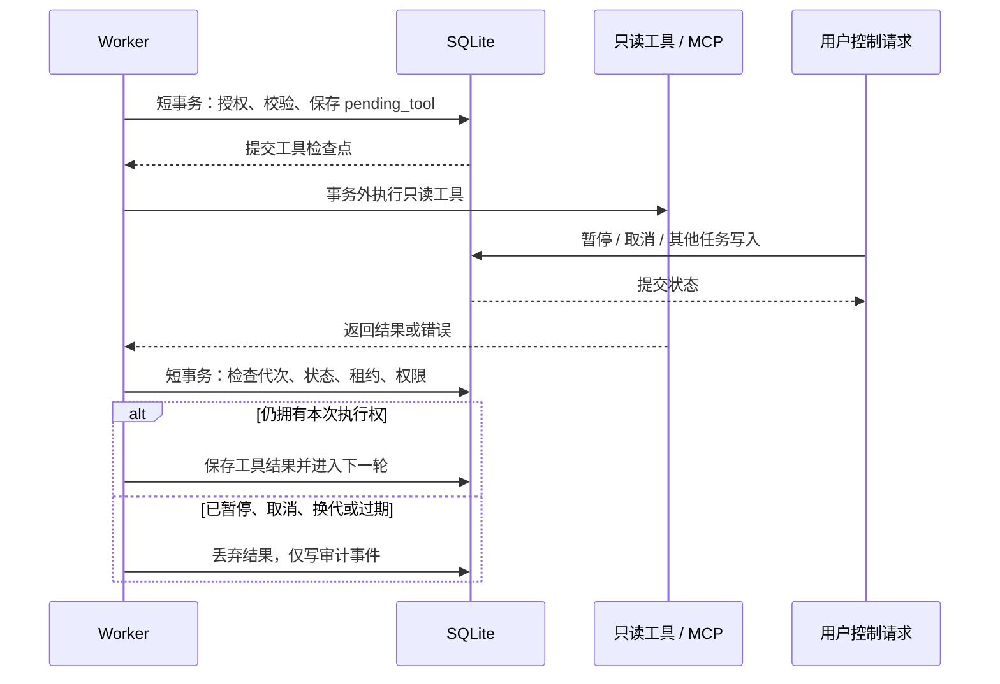

# 执行层：短事务、工具检查点与执行代次

## 问题与目标

R7 的模型请求已在数据库事务外，但模型返回工具请求后，MCP 等工具仍在 BEGIN IMMEDIATE 写事务里同步执行，等待期间可能阻塞其他写入。仅比较 worker ID 也不足以识别同一 Worker 暂停/恢复后的旧响应。

R8 把模型只读工具拆成三个阶段：

## 执行代次与租约

每次 claim 都生成新的 attempt_id，即使 worker ID 相同也不复用。结果只有在以下条件同时成立时才可提交：运行仍为 running，worker 相同，attempt_id 相同，当前租约未过期。默认 120 秒租期，R12 每 30 秒心跳续租、每代次最多续租到领取后 600 秒；详见 [租约续期与故障恢复](09-worker-leases.md)。

工具结果还检查 pending_tool ID、名称、参数及所属步骤未变；提交前重新读取用户与会话，重新执行当前工具策略和权限检查。模型回复也补充提交前 ACL 复核。暂停/恢复不需要删历史记录，Worker 变化和执行代次使旧响应失效。

迟到模型响应的内容不发布，但已报告 Token 按 attempt_id 去重计入原运行，并记录丢弃事件。没有返回 usage 的请求费用仍未知，不能以 0 Token 当作免费。

## 工具检查点与恢复

模型请求被接受时，短事务保存 pending_tool（稳定逻辑调用 ID、工具名、经过 Schema 校验的参数、步骤、状态），并预留一次逻辑工具请求预算。

- 执行前：再次检查执行权和授权，记录 tool.started。
- 执行中：不持有 SQLite 写事务；task.list 使用单独的短读连接，MCP 等待不携带写连接。
- 执行后：复核执行权和权限，提交一次工具结果，清除检查点并排队继续。
- 崩溃/租约过期：新领取者使用同一逻辑调用 ID 继续只读工具，不必重做已完成的模型请求，不重复占用逻辑工具请求次数。
- 工具失败：保留失败检查点，运行停止；用户显式恢复后可重试只读工具。不是无限自动重试。

只读工具可能物理执行多次，尤其是在返回后但结果提交前崩溃时。本实现保证受执行代次保护的结果提交，不保证外部操作 exactly-once。预算中的 tool_requests 为逻辑请求次数；恢复重试的物理调用需看 tool.started 与 attempt_id。

## 仍保留事务内的内容

本地 Decimal 预算预计算是无网络的短操作；批准后的 task.create_batch 必须继续与审批、事件同事务写入。事务外入口仅允许模型来源、L0 且无需审批的已注册工具；不把该机制推广到外部写操作。

## 验证与限制

并发测试使用事件屏障让工具保持阻塞，验证其他写入和控制请求在释放工具前完成；不靠“睡一会儿再测”判断性能。另覆盖同 Worker 的工具/模型旧响应、租约过期、ACL 撤销、检查点恢复与迟到用量记账。

暂停/取消改变的是持久状态和结果采纳权，不保证立刻中断底层只读操作；MCP 仍由其截止时间和 SDK 清理。默认嵌入 Worker 仍为单线程，一个工具等待仍占用该线程；其他 API 写入或独立 Worker 可以继续，不代表默认同一 Worker 已并行调度。

SQLite 仍是单写者，没有因此变成高并发数据库。R12 已增加有期限的心跳，但数据库不可用或超过最大续租窗口后仍可能过期并被重复调用；已完成模型调用之后、工具请求检查点提交之前崩溃，仍可能重做该模型请求并再次计费。R9/R11 已建立版本迁移并拆分运行/消息表。升级共享数据库的 Worker 时应统一版本，不支持混用旧无代次检查的 Worker 进行滚动升级。
