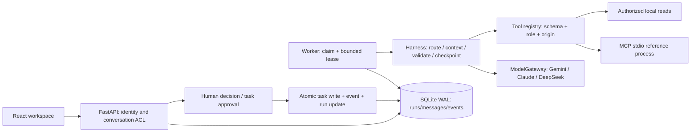

# Architecture and design decisions

FamilyAgent is a local/self-hosted personal and family collaboration application. Role agents share a durable orchestration runtime; they are not independent A2A servers.



## One meeting

1. The server authorizes the conversation and snapshots intent, role versions, constraints and model configuration.
2. A Worker atomically claims a queued/expired run. Every claim gets a fresh attempt ID. Heartbeats extend an unexpired owned lease within a fixed per-attempt deadline.
3. The host opens the meeting. Experts either see prior results (sequential baseline) or analyze independently in the first round. Independent experts cannot read peer messages from the same run.
4. The summarizer receives attributed findings. Disagreement quotes must refer to different experts and match original text; the protocol does not make the quotes factually correct.
5. Human members approve the discussion conclusion. Creating personal tasks is a separate proposal and approval transaction.

## Failure boundaries

```mermaid
sequenceDiagram
  participant W as Worker
  participant D as SQLite
  participant X as Model / readonly tool
  participant U as User API
  W->>D: claim: worker + attempt + lease
  W->>D: prepare and persist checkpoint
  W->>X: execute outside write transaction
  loop bounded heartbeat
    W->>D: renew only current unexpired attempt
  end
  U->>D: pause / cancel / revoke access
  X-->>W: result or failure
  W->>D: recheck status, attempt, lease and ACL
  alt ownership still valid
    W->>D: commit result + event + next checkpoint
  else ownership lost
    W->>D: discard content; retain reported usage once
  end
```

Read-only tools may execute more than once after a crash. A model call can be repeated if its result was never committed. Attempt fencing protects accepted state; it does not guarantee exactly-once external execution or free cancellation.

## Context and memory

System prompt plus JSON context have a 32,000-character bound. The current question, explicit constraints and required tool/financial evidence are protected; lower-priority history and memories are pruned with receipts. Token estimates are distinct from provider-reported usage.

Private memory candidates are authorized before lexical ranking. At most six are selected; meetings and emotional-support mode do not automatically read private memory. Source references are resolved against current permissions/content fingerprints when shown, with deletion states. This is not vector RAG or complete erasure of past generated replies.

## Persistence

Runs and messages have their own tables with generated query columns and explicit sequence IDs. Complex results/checkpoints remain JSON. Atomic versioned migration copies and verifies old rows before removing legacy copies; it rolls back on failure. Other entities still use the generic records table. SQLite is a single-writer design, not a multi-host distributed queue.

## Why these choices

| Choice | Reason | Trade-off |
| --- | --- | --- |
| Framework-light Python Harness | Keep budgets, checkpoints, ACL and transaction boundaries inspectable | More explicit lifecycle code to maintain |
| Deterministic demo | Offline demos and regression without provider keys | Does not establish model quality |
| SQLite + atomic claim | Small self-hosted setup and inspectable recovery | Single writer; no distributed throughput claim |
| Snapshot roles/config | Explain what a historical run actually used | Old runs may need original provider configuration to resume |
| Fixed MCP stdio service | Exercise real handshake/discovery/call with a bounded trust boundary | No arbitrary third-party URLs, OAuth or standard A2A |

For exact implementation boundaries see the execution, database, leases, CI and container documents. Tests, model evaluations, human review and production load evidence are separate layers.
